# ph-rhaibu

OODA Workshop Factory -- a skill-driven pipeline for building OpenShift/RHOAI workshops in the RHPDS [**publishing-house format**](https://github.com/rhpds/rhdp-publishing-house): one repo per workshop, from demo observations through to deployed, tested content.



## How it works

Each workshop follows the OODA loop. Run the skills in order -- and loop back when things need fixing.

| Phase | Skill | What happens |
|-------|-------|-------------|
| **Capture** | _manual_ | Record a demo video, `ffmpeg` split to keyframes |
| **Observe** | `/workshop-observe` | Analyze screenshots, extract user flows, write observations to `rac/assets/` in the workshop repo |
| **Orient** | `/workshop-orient` | Interview for requirements, create RAC artifacts (requirements, decisions, designs), synthesize `publishing-house/spec.yaml` + design + module outlines, validate |
| **Do** | `/workshop-do` | Seed the repo from `rhdp-publishing-house-template`, scaffold `content/` + `automation/` + `qa-automation/`, `make build`, `helm template`, `decided validate` |
| **Act** | `/workshop-act` | Deploy to a prelude cluster (`make deploy` via the showroom-deployer chart), Playwright browser tests, fix-and-test loop, PH-native publish |
| **Patterns** | `/demo-patterns` | Codified better-demo rules (DP-01…DP-27) mined from the live ph-* corpus — phase checklists for Orient/Do/Act/Quality |
| **Loop Back** | _team review_ | Gaps? Re-Observe. Scope change? Re-Orient. Content fix? Re-Do. All green? Ship it. |

Standalone skills.

| Phase | Skill | What happens |
|-------|-------|-------------|
| **Screenshot** | `/workshop-screenshot` | Capture live screenshots from cluster, embed `image::` refs in AsciiDoc, write RAC evidence |
| **Quality** | `/quality-enrichment` | Audit and uplift workshop quality: validate RAC coverage, audit screenshots, enrich with real code from companion repos, fix content defects |

## Quick start

Install [asdecided-core](https://github.com/asdecided/core/releases) and ensure `decided` is on your PATH.

```bash
git clone <this-repo>
cd ph-rhaibu
```

Record your demo video e.g. `workbench-create.mkv`

Create screenshots from your demo video as keyframes:

```bash
ffmpeg -i ~/Videos/workbench-create.mkv \
  -vf "thumbnail=120,setpts=N/TB" \
  -vsync vfr ~/git/ph-<slug>/rac/assets/keyframe-%03d.png
```

Then open your coding agent (OpenCode) in this repo and run:

```bash
@workshop-observe <path-to-screenshots>
```

(In Claude Code the same skills load as `/workshop-observe`.) The skills will guide you through each of the other skills. Each skill will stop for human in the loop check-fix and ask questions as needed.

## One repo per workshop

The pipeline produces ONE publishing-house repo per workshop:

```
~/git/ph-<slug>/                     # planning + content + automation + QA in one repo
├── rac/                             # decided corpus (requirements, decisions, designs, assets)
├── publishing-house/                # PH frame: spec.yaml, spec/design.md, spec/modules/, tools/
├── content/                         # Antora showroom component (antora.yml, modules/ROOT)
├── automation/                      # gitops charts + showroom-deployer/values-<slug>.yaml
├── qa-automation/                   # healthcheck.yml + e2e.yml
├── manifests/                       # optional learner-applied kustomize
├── catalog-info.yaml  CLAUDE.md  Makefile  mkdocs.yml  package.json
├── site.yml  ui-config.yml  scaffold.py  .scaffolds/  hooks/
└── .github/workflows/gh-pages.yml   # publishes to https://<org>.github.io/ph-<slug>/
```

This factory repo holds only skills and tooling -- no per-workshop state.

## Skills

All skills live in `.agents/skills/` — the agent-neutral layout OpenCode discovers
natively when you run sessions from this repo. See the Skills section in
[AGENTS.md](AGENTS.md).

Here are descriptions of the skills.

### Pipeline skills

Main pipeline

| Skill | Purpose |
|-------|---------|
| `workshop-observe` | Analyze demo screenshots into structured observations |
| `workshop-orient` | Plan the workshop with RAC artifacts + PH spec synthesis |
| `workshop-do` | Scaffold content and automation into the workshop repo |
| `workshop-act` | Deploy, test, and publish on a cluster |
| `demo-patterns` | Apply codified better-demo patterns (DP-* rules) from the ph-* corpus mining |

Standalone skills

| Skill | Purpose |
|-------|---------|
| `workshop-screenshot` | Capture live screenshots from a cluster and embed them into AsciiDoc content |
| `quality-enrichment` | Audit and uplift workshop quality: validate RAC coverage, audit screenshots, enrich with code from companion repos, fix content defects (single-workshop or monorepo mode) |

### Domain skills

| Skill | Purpose |
|-------|---------|
| `openshift-workshop-builder` | Antora/showroom content scaffolding patterns |
| `openshift-4-21-expert` | OpenShift console flows and cluster admin |
| `openshift-ai-3-3-expert` | RHOAI workbenches, model serving, pipelines |
| `playwright-cli` | Browser automation for testing |
| `/verify-content` | Validate showroom content against Red Hat quality standards (vendored from RHDP marketplace) |
| `/catalog-builder` | Build an RHDP AgnosticV catalog entry when ready to publish (vendored from RHDP marketplace) |

`verify-content` and `catalog-builder` are vendored into this repo and registered as
slash commands (`/verify-content`, `/catalog-builder`); the other domain skills are
reference-only patterns invoked by the pipeline skills.

## Publishing-house ecosystem

| Repo | Role |
|------|------|
| `rhdp-publishing-house` | The PH platform (Backstage, Central API, SonataFlow, GitOps) |
| `rhdp-publishing-house-skills` | The PH Claude Code plugin (orchestrator, intake, migrate, development) |
| `rhdp-publishing-house-template` | The per-lab template repo this factory seeds from |
| `ph-<slug>` repos | One per workshop (e.g. `ph-deploy-configure-rhoai`, `ph-operations-rhoai`, `redhat-ai-inference`, `ph-workbench-create`) |

Migration of legacy `zt-*` three-repo workshops (rac / showroom / automation) into
this format: see `.agents/skills/docs/PH-MIGRATION-RUNBOOK.md`.

## Diagram source

The pipeline diagram is a Mermaid journey chart: [`docs/ooda-workshop-factory.mdd`](docs/ooda-workshop-factory.mdd)

Rebuild with:

```bash
npx @mermaid-js/mermaid-cli -i docs/ooda-workshop-factory.mdd -o images/ooda-workshop-factory.svg -b white
```
